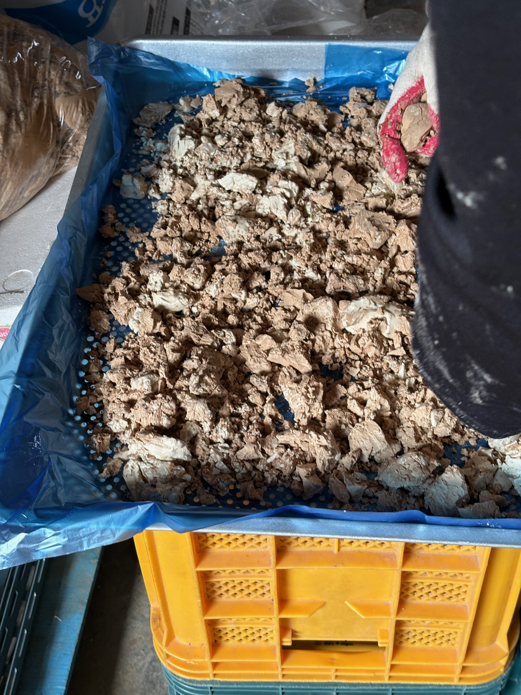
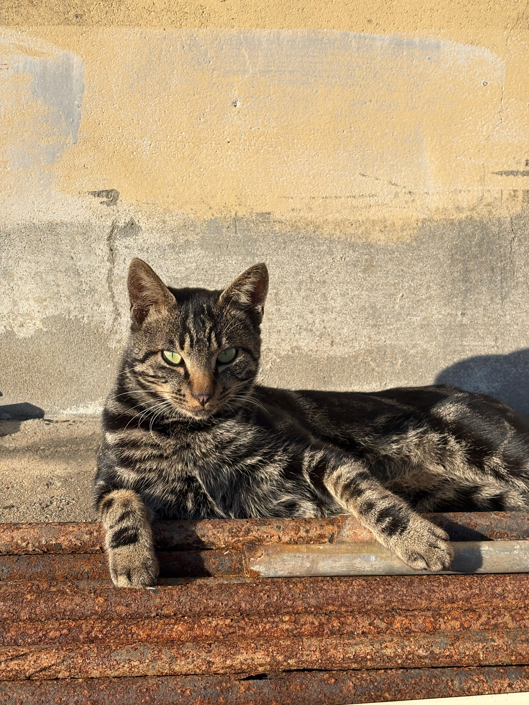
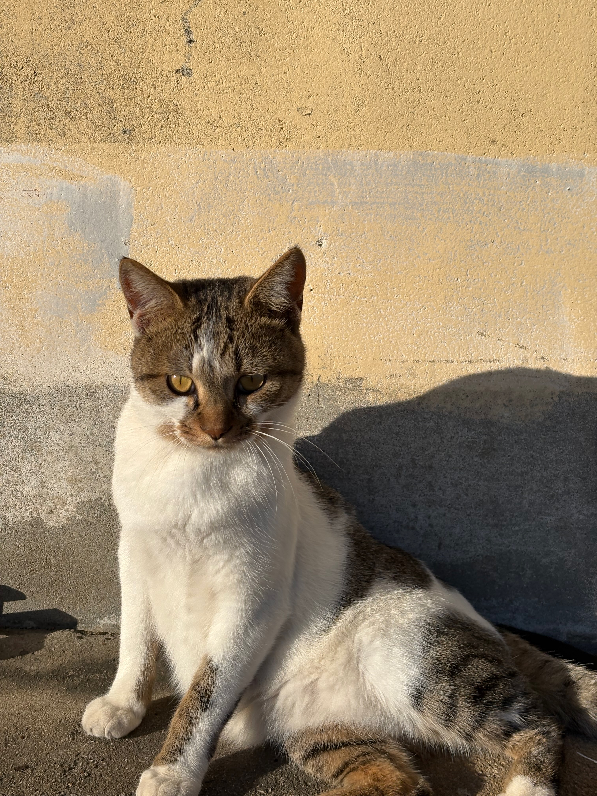
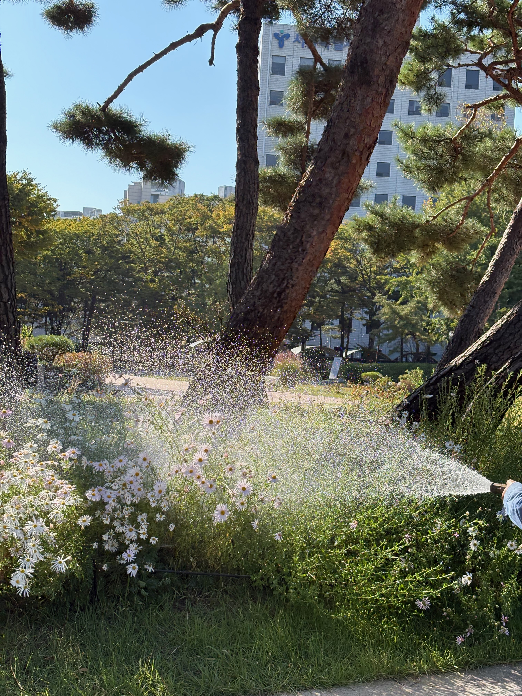
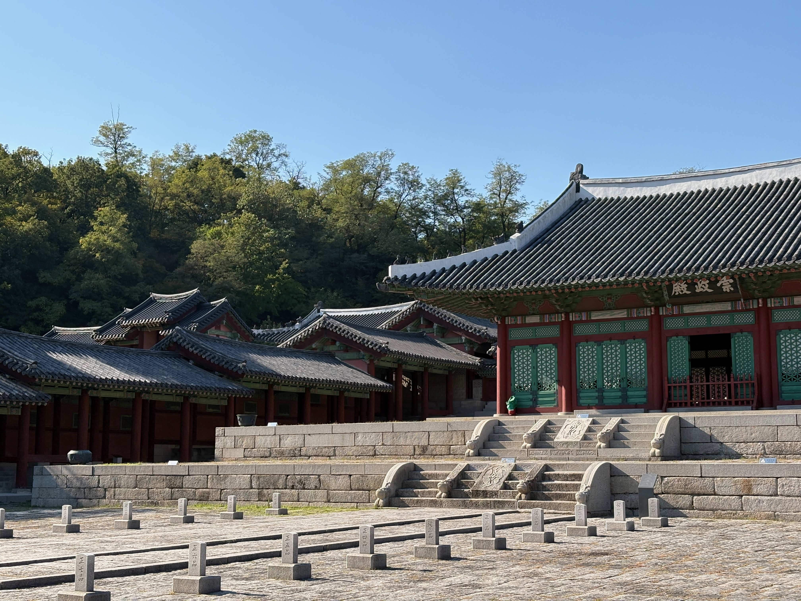
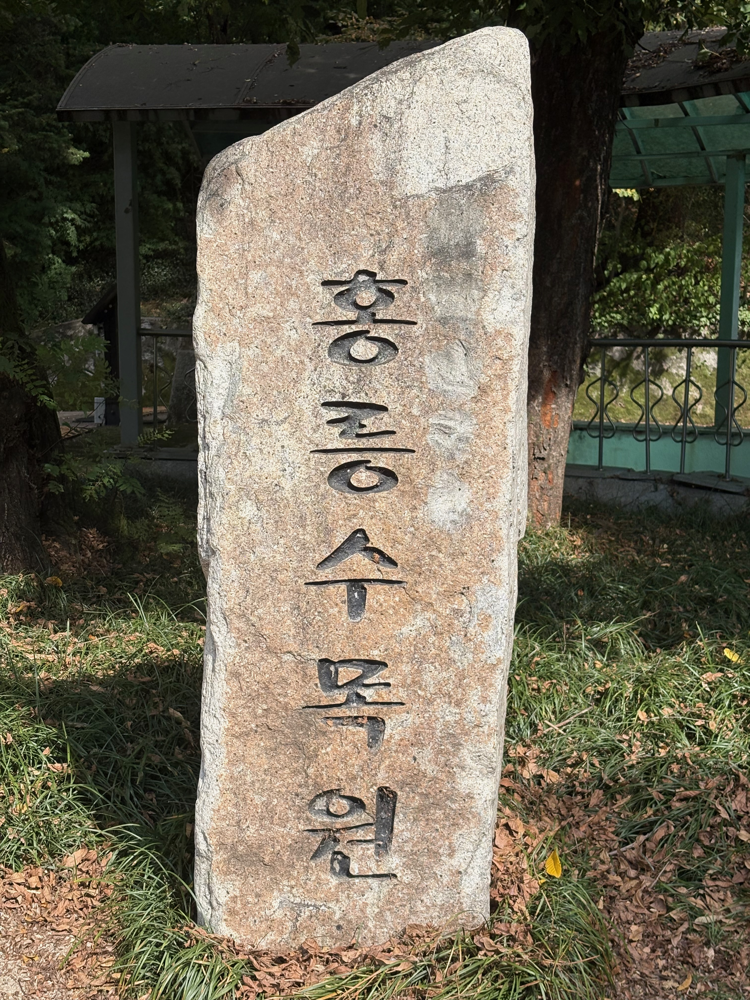
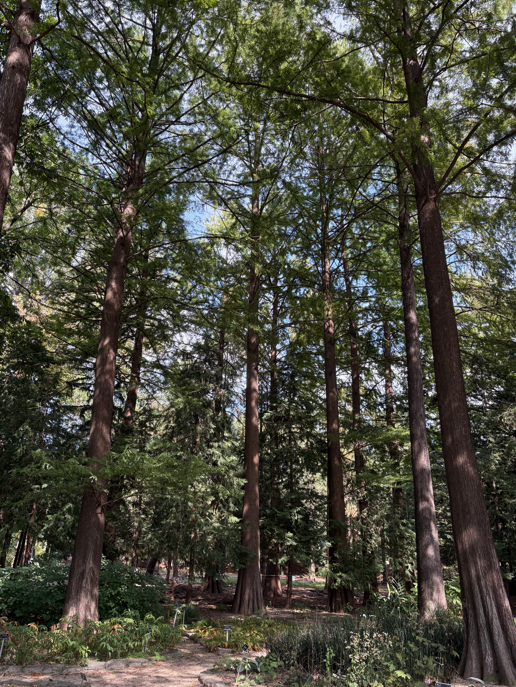
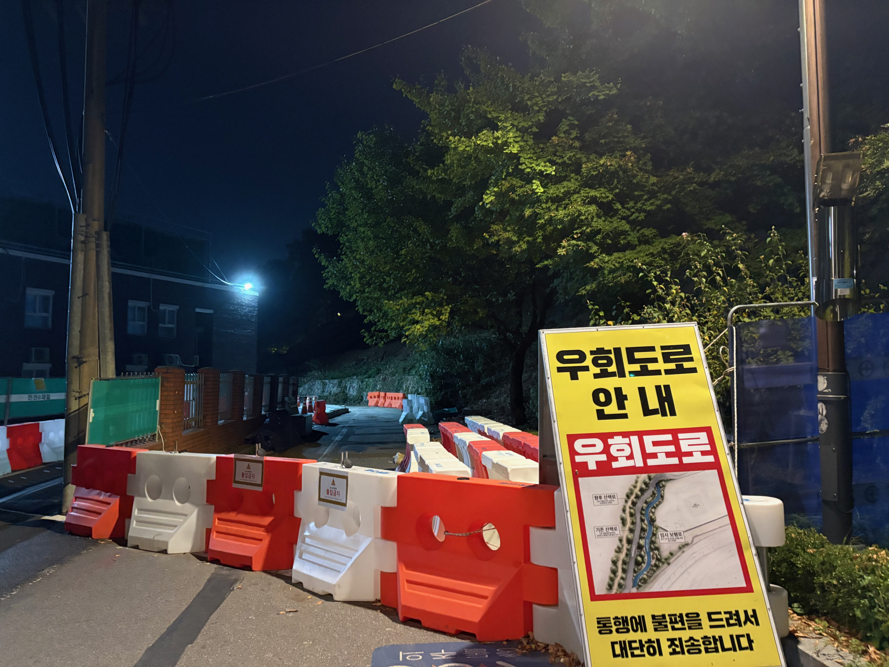
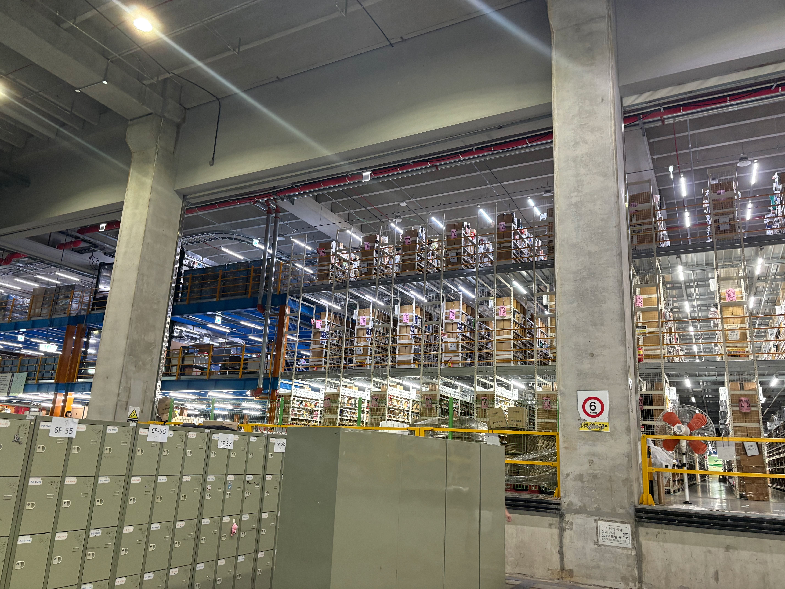
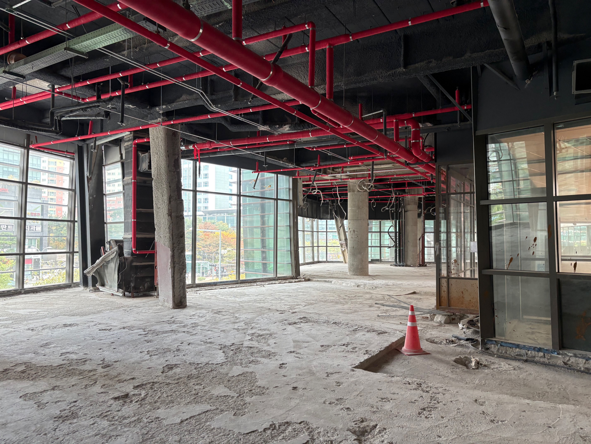

지난 달에 이어서 이번 달 초에도 시골집에 들렸다.

올해는 도토리 풍년이라 너도나도 도토리 묵을 직접 만들어 먹으려고 줍느라 한창이었다.

아래 사진은 도토리 앙금을 도토리 묵 가루로 만들기 위해 말리려고 판에 펼친 모습이다.

어김없이 고양이들이랑 같이 놀기도 했다.

화보 촬영하듯 요염하게 포즈를 잡은 고양이 두마리

까만 고양이가 더 귀엽지만 이 녀석은 소심해서 가까이 다가가면 아직도 겁을 먹는다.

그래도 가만히 있으면 먼저 다가와서 치근대고는 한다.

<video controls>
    <source src="./videos/시골집까만고양이.mov">
</video>

웃긴게 얘네들은 서로 그루밍을 해주다가 몸싸움을 한다.

장난으로 시작했다가 가끔은 소리까지 내며 진심으로 싸우는 것 같은 모습을 보인다.

<video controls>
    <source src="./videos/시골집고양이들2.mov">
</video>

이 친구들만 그러는게 아니라 도림천의 춘장이와 춘장이 친구인 하얀 고양이도 마찬가지다.

아 쓰다듬어 주는게 장난치자는 신호인건가.

<video controls>
    <source src="./videos/도림천고양이들.mov">
</video>

종로구에 있는 경희궁과 동대문구에 있는 홍릉수목원이라는 곳에 갔었다.

올해 처음 간 곳들을 정리해보니 꽤 많은 장소를 갔었다. 연말에 총정리해서 회고해볼 생각이다.

경희궁은 체감상 5대 궁궐 중 사람들의 발길이 제일 적은 것 같다.

입구가 창덕궁이나 경복궁 광화문 같이 궁궐이라는 느낌을 주지 못하는게 크지 않을까 싶다.

조경을 관리하는 할아버지가 꽃에 물을 주고 있었다.

조선시대 때는 상당히 큰 규모의 궁이었으나 경복궁 중건으로 인해 현재는 몇 개의 전각 밖에 남지 않았다.

아래는 경희궁의 정전인 숭정전의 모습이다.

홍릉수목원(홍릉시험림, 홍릉숲)은 우리나라 최초의 수목원이다. 

홍릉이라고 하는 이름은 명성황후 능의 이름이다. 현재는 다른 곳으로 능이 옮겨졌지만 그 이름은 여전히 사용되고 있다.

나무와 숲에 대해 알려주기도 하고 걸어보면서 직접 살펴볼 수 있는 곳이다.

생각보다 규모가 커서 전부 돌아다니기엔 체력적으로 힘들 수 있다. 부분 경로만 여유있게 걷는 게 좋을 듯.

그리고 보다 보니까 그게 그거인 것 같았다. 다음 번에 간다면 해설을 예약해서 설명을 들어보려고 한다.

주에 세 네번씩 가는 보라매공원에서는 산책로 공사가 진행 중이다.

올해 중순부터 시작했는데 내년 5월쯤 끝난다고 한다.

이런 공사가 반갑다. 지금은 길이 좁아서 약간 불편하더라도 내년에는 새로운 모습으로 공원을 걸어다녀볼 수 있기 때문이다.

이곳저곳을 돌아다니거나 산책 프로젝트를 하면서 느낀 것 중에 한 가지는 난 직접 느끼고 만드는 걸 좋아하는 성향을 가졌다는 것이다.

이미 은연 중에 알고는 있었지만 확실해졌다.

퇴사 이후 몇 개월 간 방황과 고민을 하면서 개발자의 길을 가지 않기로 결정했다.

본업으로 이 일을 하지 않는 것일 뿐 개발 자체는 꾸준하게 할 생각이다. 

소프트웨어를 만드는 것도 좋아한다. 당장 다음 달 앱 출시를 준비하고 있으니까.

대신 무엇이 됐든 간에 현장 일을 해보며 직접 내 손으로 만들어보고 싶었다. 

사소한 거 하나라도, 아니 완성품이 아니더라도 그냥 현장에서 일하고 싶었다. 

맨날 하루종일 의자에 앉아서 모니터를 쳐다보는게 이젠 질렸고 앞으로 십 몇 년동안 이 생활만 해야한다고 생각하면 벌써부터 진저리가 났다.

그래서 당장 현장을 경험을 해볼 수 있는 쿠팡 물류를 뛰었다. 

고양 1센터/CFC 센터와 인천 28센터에서 출고(집품, 포장), 허브(적재) 일을 해봤다.

워낙 공장이 대규모고 사람도 많아서 처음에는 약간 겁이 났었지만 금방 적응했다. 애초에 단순 반복 노동이다보니 기술이 필요하지 않았다.

용돈벌이로 하루 이틀 일을 하거나 목돈이 필요한 사람들한테는 괜찮은 일이겠지만 나에겐 아니었다.

물류센터 일은 몸을 쓰긴 하지만 가치를 창출할 수 없기 때문이다.

작더라도 문제를 해결하거나 무언가를 일궈내기보다는, 무한히 반복되는 굴레의 공정 속에서 움직이는 기계가 되어야 했었다.

입고, AR, ICQA, 재고관리 등의 포지션이나 계약직, PS, 관리자 등의 직급도 있긴 하지만 옆에서 바라봤을 때 역할만 달라졌을 뿐 본질은 비슷해보였다.

그래서 쿠팡 대신 노가다를 시작했다. 신도림에 있는 현대백화점 디큐브시티점이 폐점되고 리모델링 중인 건설 현장을 나가고 있다.

말로만 듣던 노가다를 직접 해보니 나름 할만했다. 

이것저것 배우기도 하고 작업을 하는게 재밌기도 하다.

건설과 인테리어 쪽에서도 다양한 분야가 나뉘어 있어서 당분간은 고민 좀 해볼 생각이다.

현장 내에서 인테리어 목공 일을 50년째 하시는 고수가 있는데 가끔씩 이 분한테 가서 아무거나 물어보곤 한다.

요새는 블루칼라 직종에 젊은 사람이 없고 외국인들이 많이 꾀차고 있어서 오래 배울 생각을 가지고 한다면 젊은 나이의 같은 한국 사람이 좋지 않을까 싶다.

AI이니 자동화니 뭐니 하긴 하는데 그게 두려워서 아무것도 안하는 것 보다는 일단 움직이는 게 맞는 것 같다.

모사를 하는게 아니라 새하얀 도화지에 붓을 들고 한 번 칠한 다음에 어디를 칠할지 고민하는 것이다.
